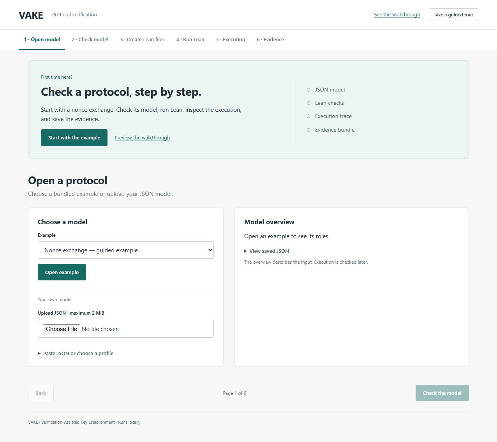
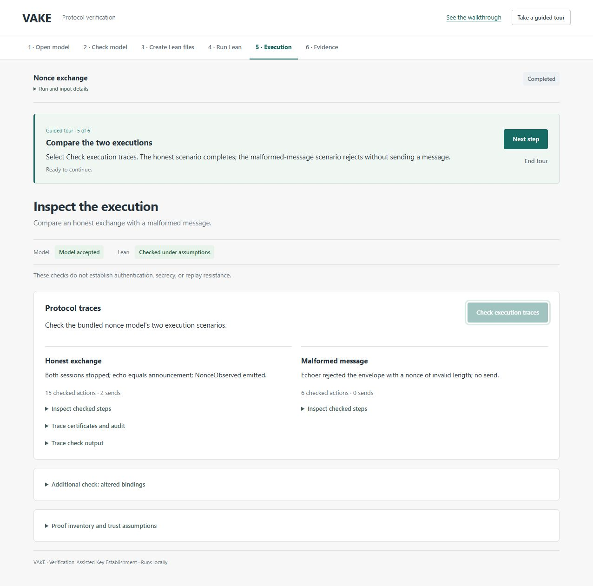

# Start here: try VAKE

Run one nonce-exchange example from input to checked execution, then save its evidence.



## Open the tool

With Docker and Compose installed, run from the repository:

```bash
docker compose build
docker compose up -d
```

Enter **http://127.0.0.1:8765** in your browser's address bar and select **Take a guided tour**. The tour creates a fresh example; it does not load a saved proof result. For a native installation, follow the [installation instructions](../README.md#native-installation).

The [Docker guide](docker.md) covers tool versions, reproduction, and stopping the tool. GitHub displays this walkthrough as a document; the interactive checks run locally.

## 1. Open the example

Choose **Nonce exchange** and select **Open example**. Inspect the two roles. VAKE saves a separate input copy for every run. The guided tour does this step for you.

## 2. Check the model

Select **Check model**. Continue when the model is accepted. This checks JSON syntax, types, and supported operations.

If an input is rejected, open its command result to read the diagnostic. To see an example, expand **Try a rejected input** and open the type-mismatch model.

## 3. Create the Lean files

Select **Create Lean files**. The generated representation is ready for checking. Creating files alone does not check a proof.

## 4. Run Lean

Select **Run Lean checks** and wait for the result. VAKE independently imports the source and checks its bindings to the generated target and the named certificates.

**Checked under assumptions** means the reported certificates passed under the selected profile and logical assumptions. It does not establish authentication, secrecy, or replay resistance. Expand **Certificate scope and assumptions** when you need the precise scope.

## 5. Inspect the execution

Select **Check execution traces**. Compare the two bundled scenarios:

| Scenario | Checked actions | Sends |
|---|---:|---:|
| Honest exchange | 15 | 2 |
| Malformed-message rejection | 6 | 0 |

These counts describe this example. Expand **Inspect checked steps** to see events, values, source locations, and certificate names. **Additional check: altered bindings** runs the two optional tampering controls.



## 6. Save the evidence

Select **Download evidence ZIP**. Keep the model, profile, generated Lean files, commands, outputs, and hash manifest together.

The bundle contains the run's current state, including unfinished checks. Use **Logs and saved files** for raw outputs, or **Reproduce this run from the command line** for replay commands.

## After the tour

Select **Finish tour** to return to ordinary navigation. You can inspect the same run or start another example. Reloading preserves the selected run and tour step.

Upload your own JSON through **Open model**. Execution traces are available for the bundled nonce, DH, and signed-DH examples when their scenario files match the exact model/profile bytes. See [scenario files](scenarios.md). The signature example demonstrates signature construction with limited executable observations; it is not a protocol-authentication proof.

The [technical guide](ui-user-guide.md) explains every evidence field. Read [limitations](limitations.md) for the supported scope and assumptions.

The screenshots illustrate a historical UI run. They do not validate this source revision. Their original identifiers and hashes are recorded in [the capture manifest](onboarding/capture-manifest.json).
